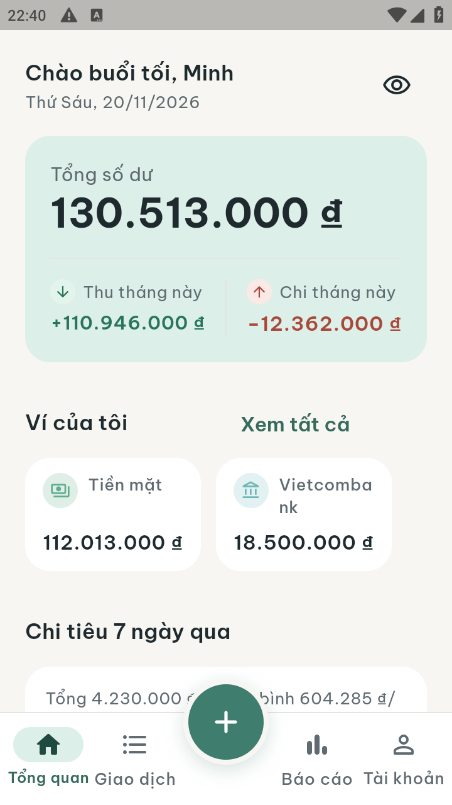
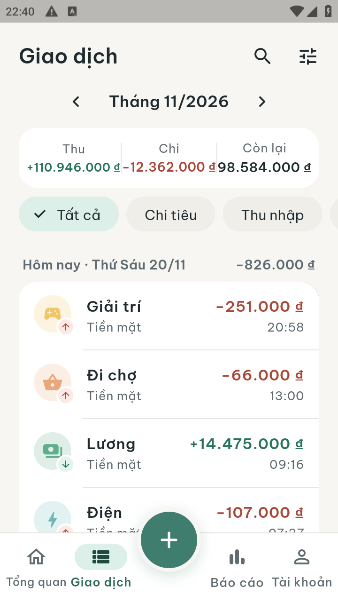
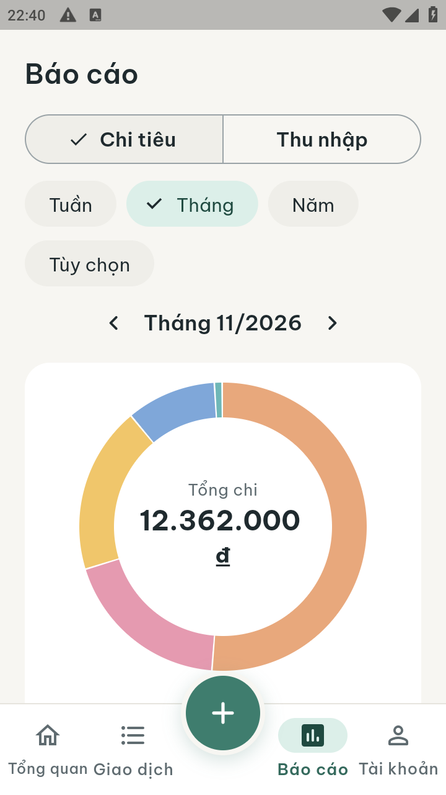
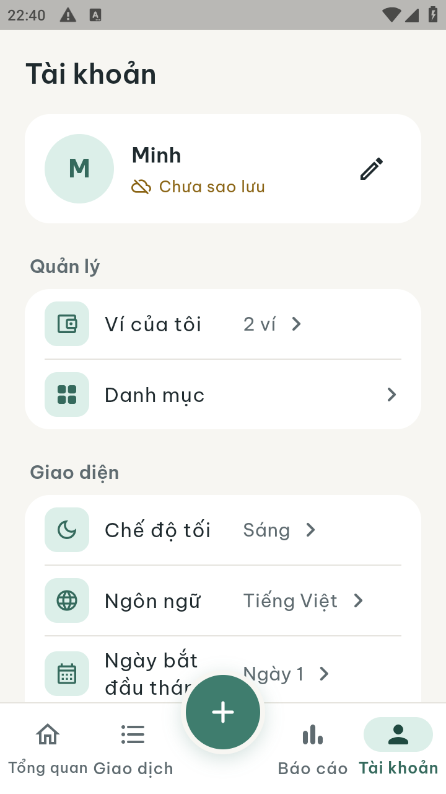
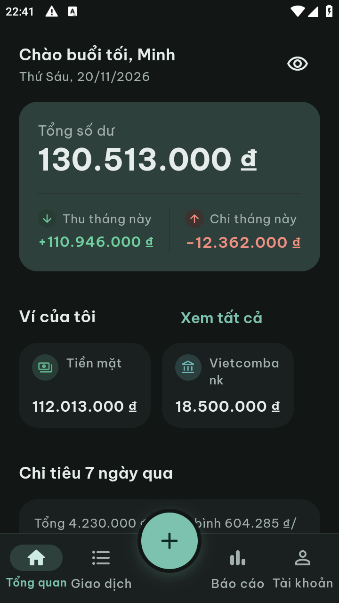
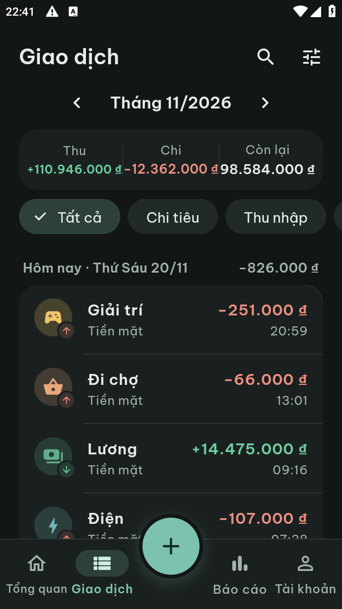
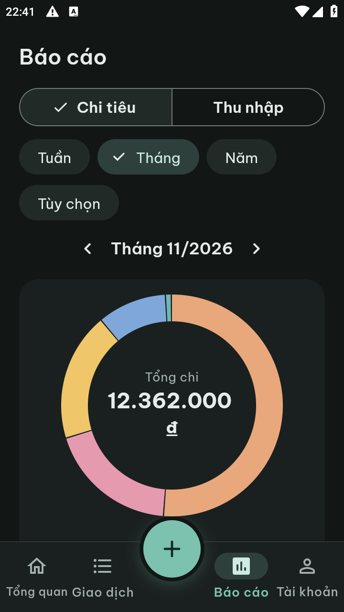
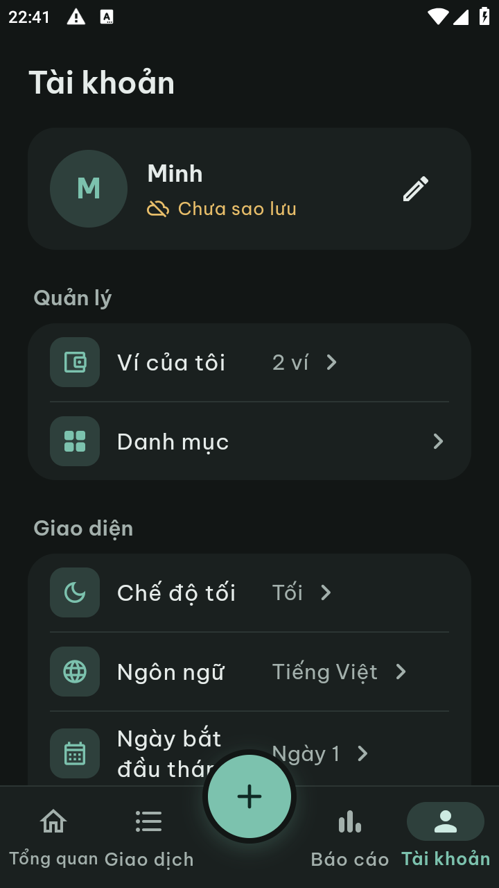

# Ví Xanh

App quản lý chi tiêu cá nhân (VND), offline-first: dữ liệu nằm trong SQLite trên máy là bản chuẩn.
Flutter 3.32.1 stable · Dart ^3.8.1 · Riverpod 3 · go_router · drift · gen-l10n.

## Tính năng MVP

- **Bắt đầu**: 3 trang giới thiệu → đặt tên, ngày bắt đầu tháng tài chính → tạo ví đầu tiên.
- **Tổng quan**: tổng số dư (ẩn/hiện được), thu/chi tháng này, các ví, chi tiêu 7 ngày, giao dịch gần đây.
- **Giao dịch**: thêm chi / thu / chuyển khoản bằng bàn phím số riêng (cộng trừ, số tiền nhanh,
  danh mục dùng gần đây); danh sách theo tháng, lọc, tìm không dấu; chi tiết, sửa, xóa có Hoàn tác.
- **Ví**: nhiều loại ví (tiền mặt, ngân hàng, ví điện tử, thẻ tín dụng...), tổng tài sản / nợ / ròng,
  chi tiết ví với biểu đồ 30 ngày, lưu trữ ví.
- **Danh mục**: danh mục mặc định có mục con; thêm, sửa, xóa, sắp xếp lại.
- **Báo cáo**: theo tuần / tháng / năm / tùy chọn; cơ cấu theo danh mục, so với kỳ trước, thu – chi 6 kỳ.
- **Tài khoản**: sửa tên, chế độ tối, ngôn ngữ (vi/en), ngày bắt đầu tháng, ẩn số dư; **sao lưu**
  ra file `.sqlite` rồi chia sẻ lên Drive/Zalo/máy, có nhắc khi lâu chưa sao lưu.

Ảnh chụp: [`docs/screenshots/mvp/`](docs/screenshots/mvp/) (sáng, tối, English, chữ 2x) kèm danh sách
chỗ lệch đã rà soát.

| Tổng quan | Giao dịch | Báo cáo | Tài khoản |
|---|---|---|---|
|  |  |  |  |
|  |  |  |  |

## Chạy app

```bash
flutter pub get
dart run build_runner build --delete-conflicting-outputs
dart format lib/data
flutter gen-l10n
flutter run
```

Trên Windows cần bật **Developer Mode** (`start ms-settings:developers`), nếu không `flutter pub get`
báo lỗi symlink và không build được app (test vẫn chạy).

Đổi schema DB hoặc cài lại sau khi schema v1 thay đổi trong lúc phát triển: gỡ app cũ trên máy trước.

## Sinh code

| Lệnh | Sinh ra |
|---|---|
| `dart run build_runner build --delete-conflicting-outputs` | `lib/data/**/*.g.dart` (drift) |
| `dart format lib/data` | Chạy ngay sau build_runner: bản build sạch sinh `database.g.dart` chưa theo `page_width: 100` |
| `flutter gen-l10n` | `lib/l10n/gen/` từ `app_vi.arb` (template) và `app_en.arb` |
| `dart run drift_dev make-migrations` | `drift_schemas/` + test migration, chạy mỗi khi tăng `schemaVersion` |

## Kiểm tra trước khi xong một việc

```bash
dart format --set-exit-if-changed .
```

```bash
flutter analyze --fatal-infos
```

```bash
flutter test
```

```bash
flutter test integration_test -d emulator-5554
```

Integration test cần thiết bị/emulator Android:

- `app_test.dart`: khởi động app thật (DB thật trên máy).
- `mvp_flow_test.dart`: luồng chính như cài mới, chạy trên DB trong RAM nên không đụng dữ liệu
  trên máy. Gồm onboarding → thêm ví → chi/thu/chuyển → Tổng quan → xóa + hoàn tác → Báo cáo →
  sao lưu ra file thật.
- `perf_scroll_test.dart`: 10.000 giao dịch giả, cuộn danh sách. Chỉ có ý nghĩa ở profile mode:

```bash
flutter drive --profile --no-dds --driver=test_driver/perf_driver.dart --target=integration_test/perf_scroll_test.dart -d emulator-5554
```

  Kết quả ghi vào `build/integration_response_data.json`.

- `screenshots_test.dart`: chạy qua `tool/capture_screenshots.sh` để chụp ảnh vào `docs/screenshots/mvp/`.

Dữ liệu giả cho debug: `lib/debug/demo_seed.dart` (`seedDemoTransactions`, ném lỗi nếu chạy ở bản
release).

## Cấu trúc thư mục

```
lib/
├── main.dart          # chỉ gọi bootstrap()
├── bootstrap.dart     # composition root: bắt lỗi → đọc cài đặt → mở DB → ProviderScope → runApp
├── app.dart           # MaterialApp.router
├── core/              # thuần Dart: Result, Failure, Money, Clock, ids, enums, formatting/
├── data/              # drift: database.dart, tables/, daos/, seed/, migrations/
├── services/          # interface + impl hạ tầng (key-value store, backup, notification, ...)
├── native/            # MethodChannel/EventChannel — nơi duy nhất gọi native
├── routing/           # routes.dart, router.dart, app_shell.dart
├── theme/             # tokens, AppColors, typography, AppTheme, widgets/ dùng chung
├── l10n/              # app_vi.arb, app_en.arb, gen/
└── features/<x>/{data,domain,presentation}
assets/fonts/          # Be Vietnam Pro + OFL.txt
drift_schemas/         # snapshot schema từng phiên bản
test/                  # cấu trúc giống lib/, fakes/, policy/
```

## Quy ước

- Feature-first + MVVM 3 lớp. View "dumb", Notifier giữ state bất biến, Repository là đường ghi duy
  nhất và trả `Result<T>` — không ném exception ra ngoài repository.
- Chỉ `bootstrap.dart` nhắc tới implementation cụ thể; provider hạ tầng ném lỗi tới khi được override.
- Tiền là `int` theo đơn vị nhỏ nhất (VND = đồng), dùng `Money`. Không bao giờ dùng `double` cho tiền.
  `amount` của giao dịch luôn > 0, chiều tiền nằm ở `type`. Số dư luôn tính lại từ giao dịch.
- Thời gian lấy qua `Clock`, không gọi `DateTime.now()` trong logic. DB lưu epoch ms UTC.
- Id là UUID (v4; danh mục mặc định dùng v5 cố định theo `system_key`). Xóa là xóa mềm (`deleted_at`).
- Route path chỉ khai báo trong `lib/routing/routes.dart`. Màu/spacing/bo góc chỉ lấy từ `lib/theme/`.
- Chuỗi hiển thị chỉ nằm trong ARB (`test/policy/` chặn `Text('...')` tiếng Việt viết cứng).
- Định dạng tiền/ngày chỉ qua `lib/core/formatting/`.
- Test tự viết fake (`test/fakes/`), không mock; DB test dùng `inMemoryDatabase()`.
- Migration: mỗi lần tăng `schemaVersion` thêm một nhánh `from < N`, không sửa nhánh cũ.

## Font

Be Vietnam Pro (Regular 400, Medium 500, SemiBold 600, Bold 700) đóng gói trong `assets/fonts/`, lấy từ
kho [google/fonts](https://github.com/google/fonts/tree/main/ofl/bevietnampro). Giấy phép SIL Open Font
License 1.1 — xem `assets/fonts/OFL.txt`. Font không có chữ số đều độ rộng (`tnum`), nên số tiền không
thẳng cột tuyệt đối.

## Kết quả rà soát cuối MVP (20/11/2026)

| Kiểm tra | Kết quả |
|---|---|
| `flutter clean` → `pub get` → build_runner → `dart format lib/data` → gen-l10n | Đạt. Riêng `pub get` báo lỗi symlink vì Windows chưa bật Developer Mode; build Android vẫn chạy |
| `dart format --set-exit-if-changed .` · `flutter analyze --fatal-infos` | Sạch |
| `flutter test` | 318/318 đạt |
| `integration_test/mvp_flow_test.dart` trên emulator Android 9 | Đạt |
| 10.000 giao dịch, cuộn danh sách ở profile | 717 khung hình, **0 khung trễ**; dựng khung trung bình 1,6 ms (p99 5 ms), raster trung bình 2,5 ms (p99 6,5 ms); mở tab Giao dịch 0,7 s; ghi 10.000 dòng 0,4 s |
| Mở app nguội (profile, `am start -W`) | 0,84–1,27 s trên emulator |
| Grep quy ước | Không có `DateTime.now()` trong logic (chỉ ở `crash_log.dart`), không dùng `double` cho tiền, không có màu ngoài theme (trừ `Colors.transparent`), không có path ngoài `Routes`, không có catch rỗng. Các mục ẩn (ngân sách, PIN, thông báo, CSV, khôi phục, xóa dữ liệu) không còn trong UI |

## Nợ kỹ thuật còn lại (sau MVP)

- **Thêm giao dịch trên màn thấp (≤ 640dp):** lưới danh mục nằm dưới bàn phím số; ở chữ 2x, bàn
  phím che cả ô số tiền. Xem `docs/screenshots/mvp/README.md`.
- **Tên ví một từ dài** bị ngắt giữa chữ ở thẻ ví và danh sách ví.
- Mới chạy trên emulator 360×640, chưa thử điện thoại thật và màn cao.
- Windows chưa bật Developer Mode: `flutter pub get` lỗi ở bước symlink, chưa build được bản desktop.
- Các plugin yêu cầu Android NDK 27.0.12077973, project đang dùng 26.3. Gradle chỉ cảnh báo; thêm
  `ndkVersion` vào `android/app/build.gradle.kts` khi đã cài NDK 27.
- Sao lưu hiện là bản chép nguyên file SQLite: chưa có khôi phục, chưa có định dạng JSON có phiên
  bản, chưa có xóa toàn bộ dữ liệu. Làm ở tuần 7–8.
- Các tab ẩn vẫn nghe DB (`BranchStack`), nên mỗi lần ghi, truy vấn của cả 4 tab đều chạy lại. Với
  10.000 giao dịch vẫn mượt; đo lại nếu dữ liệu lớn hơn nhiều.
- Test widget: transaction của drift chạy trong `tester.runAsync` sẽ treo nếu cây widget đang giữ
  truy vấn. Phải seed dữ liệu trước khi `pumpWidget`.
- `applicationId`/`namespace` Android còn `com.example.vi_xanh_app`; label app còn `vi_xanh_app`.
- Bản release đang ký bằng debug key.
- Tên danh mục mặc định lưu tiếng Việt, chưa dịch theo ngôn ngữ app (`system_key` đã có sẵn để làm).
- Be Vietnam Pro không có `tnum`: số tiền chưa thẳng cột.
- FK `transactions.bank_event_id` / `recurring_id` chưa có — thêm bằng migration khi tạo 2 bảng đó.
- Test widget chạy bằng font giả của Flutter; bố cục với font thật chỉ được kiểm qua ảnh chụp.
- `NotificationService`, `SyncService`, `AuthService` vẫn là bản tạm/noop.
- Lỗi chưa gửi lên dịch vụ giám sát (Crashlytics/Sentry) — mới ghi file `crash.log` cục bộ.
- Đang ẩn cho tới khi làm: ngân sách, giao dịch định kỳ, kết nối ngân hàng, quy tắc tự phân loại,
  gợi ý chi tiêu, PIN / màn khóa, thông báo, xuất/nhập CSV, khôi phục, ảnh hóa đơn.
- Chưa có CI (cố ý để sau).
